# DATABASMODELLERING

## VERKSAMHETSBESKRIVNING: PERSONAL och AVDELNINGAR

### PERSON:

- person_id : INT (PK)
- first_name : VARCHAR NOT NULL
- last_name : VARCHAR NOT NULL
- email : VARCHAR NOT NULL UNIQUE
- employment_date : DATE NOT NULL

- section_id : INT NOT NULL (FK)

### SECTION:

- section_id : INT (PK)
- section_name : VARCHAR NOT NULL
- city : VARCHAR NOT NULL

## VERKSAMHETSBESKRIVNING: PASSERKORT

### ACCESS_CARD:

- access_card_id : INT (PK)
- person_id : INT NOT NULL UNIQUE (FK)
- card_number : VARCHAR NOT NULL UNIQUE
- issue_date : DATE NOT NULL
- validity_date : DATE NOT NULL

## VERKSAMHETSBESKRIVNING: KOMPETENSER

### COMPETENCE

- competence_id : INT (PK)
- competence_name : VARCHAR NOT NULL UNIQUE
- description : VARCHAR NOT NULL

### PERSON_COMPETENCE

- person_id : INT (PK, FK)
- competence_id : INT (PK, FK)

## Relationer och Kardinalitet

### PERSON och SECTION

En anställd måste tillhöra en avdelning, medan en avdelning kan ha flera eller inga anställda. Relationen är därför
en-till-många.

### PERSON och ACCESS_CARD

En anställd kan ha noll eller ett passerkort, medan ett passerkort måste ha en person. Relationen är därför en-till-en.

### PERSON och COMPETENCE

En anställd kan ha noll eller flera kompetenser, medan en kompetens kan vara kopplad till noll eller flera anställda.
Relationen är därför en många-till-många. För att visa relationen använder jag kopplingstabellen 'PERSON_COMPETENCE'

## MOTIVATION

Alla attribut som har NOT NULL, är för att man måste sätta ett värde på de och dem med UNIQUE är för att ingen annan rad
får ha samma värde i kolumnen.

Jag använder section_id som primärnyckel i 'Section' och som främmande nyckel i 'Person' för att koppla varje anställd
till sin avdelning. I 'Access_Card' använder jag person_id som främmande nyckel för att koppla passerkortet till en
annstäld. Jag använder även UNIQUE på person_id för att se till att en anställd inte får fler än ett passerkort.

Jag använder 'Person_Competence' som kopplingstabell eftersom relationen mellan 'Person' och 'Competence' är
många-till-många. Jag använder person_id och competence_id som främmande nycklar och som en sammansatt primärnyckel.

# JAVA DELEN

### Klasserna

- Person
- Section
- AccessCard
- Competence

Jag skapade klasserna som representerar tabellerna från SQL, och la till relevanta attribut. Till skillnad från SQL där
jag använde främmande nycklar, använder jag istället objekt i Java för att visa relationerna i Java.

När jag skapar en person skickar jag in ett 'Section'-objekt i konstruktorn. Flera personer kan referera till samma
objekt, vilket är en en-till-många relation.

Jag skapade även två konstruktorer i 'Person'-objektet för att kunna skapa en person med eller utan passerkort.

För att göra liknande 'AUTO_INCREMENT' från SQL, i Java, använde jag ett statiskt id som ökar varje gång ett nytt objekt
skapas.

Jag skapade en klass 'Competence' för att representera 'Competence'-tabellen från SQL. Eftersom relationen mellan '
Person' och 'Competence' är många-till-många använder jag en lista med 'Competence'-objekt i 'Person'-klassen. I '
Person'-objektet i addCompetence använder jag .contains() för att se ifall kompetensen redan finns, så att den inte
läggs till flera gånger.

## VG3

En anställd kan ge flera rader eftersom den kan ha flera kompetenser. Eftersom vi söker efter kompetenser så kommer den
visa så många kompetenser som har person_id.

När man kör en anställd som inte har ett passerkort eller en registrerad kompetens, ser man ändå allt. Eftersom jag kör
LEFT JOIN så tar den ändå med de som saknar.

## VG4

I 'INNER JOIN' försvinner den avdelningen som inte har någon 'Person'.
Den finns kvar i 'LEFT JOIN' eftersom den visar avdelningen oavsett om den har några anställda eller inte.
Det visas 'NULL' på den anställde på den raden.

# Bilder

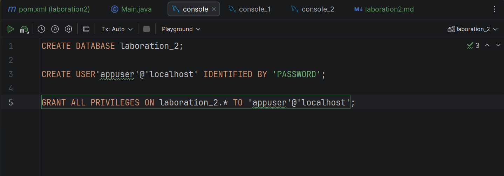
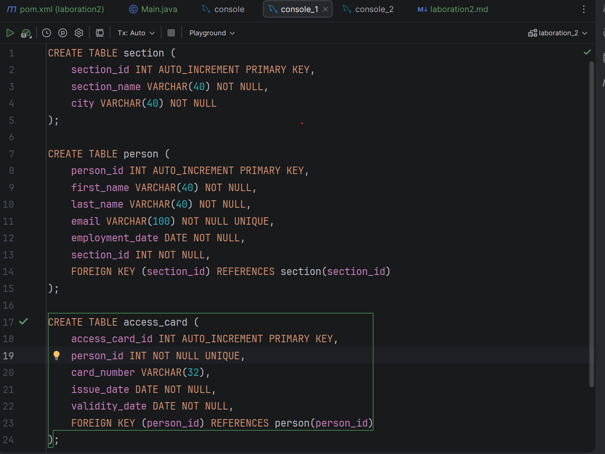
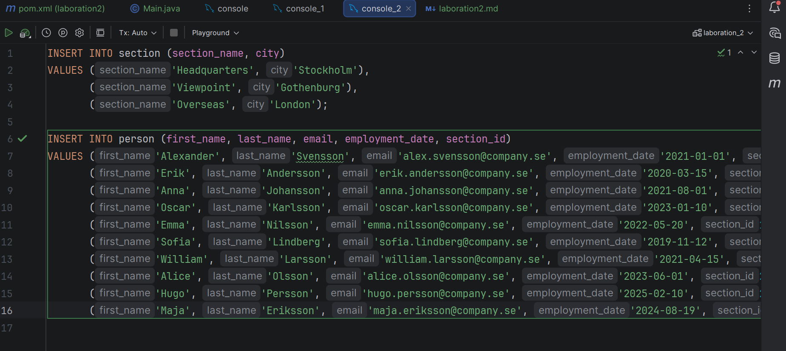

# G1

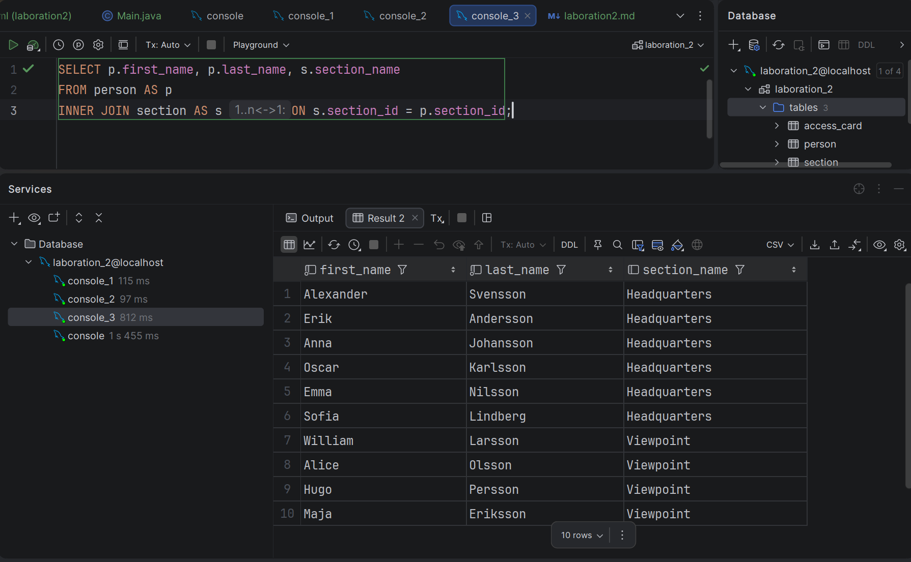

# G2

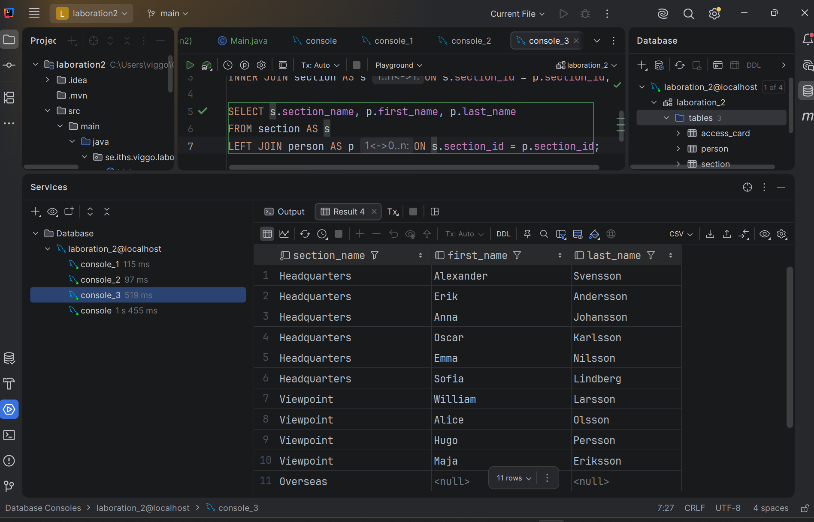

# Testdata VG

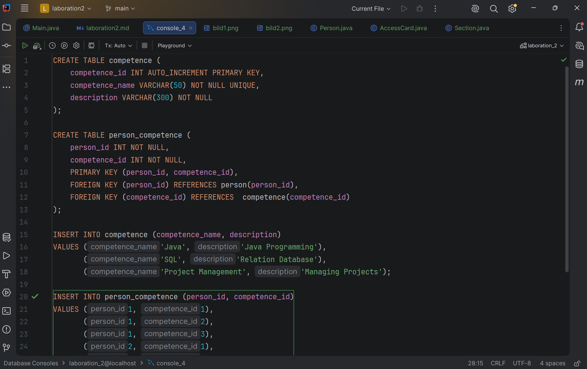

# VG1

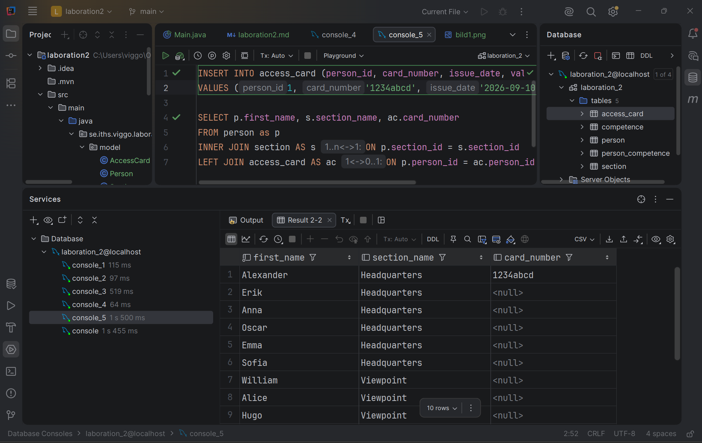

# VG2

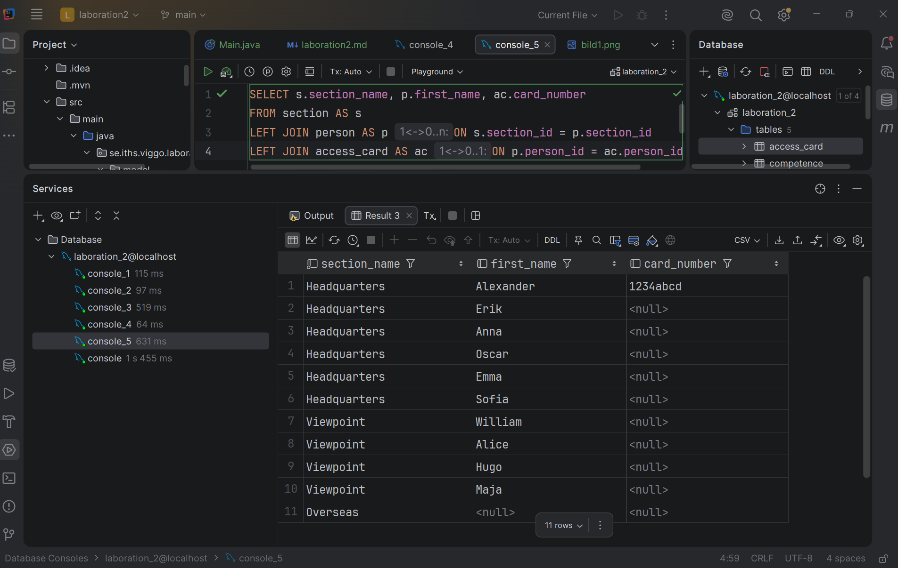

# VG3

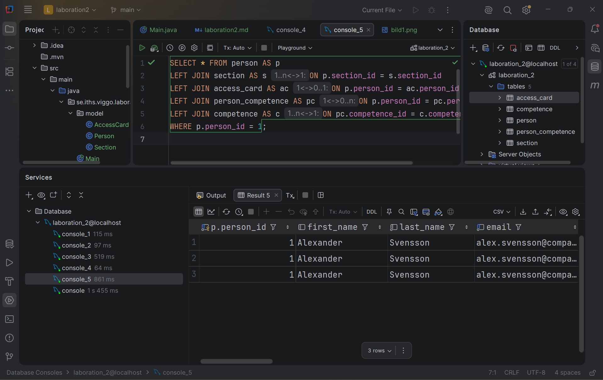

# VG4 INNER JOIN

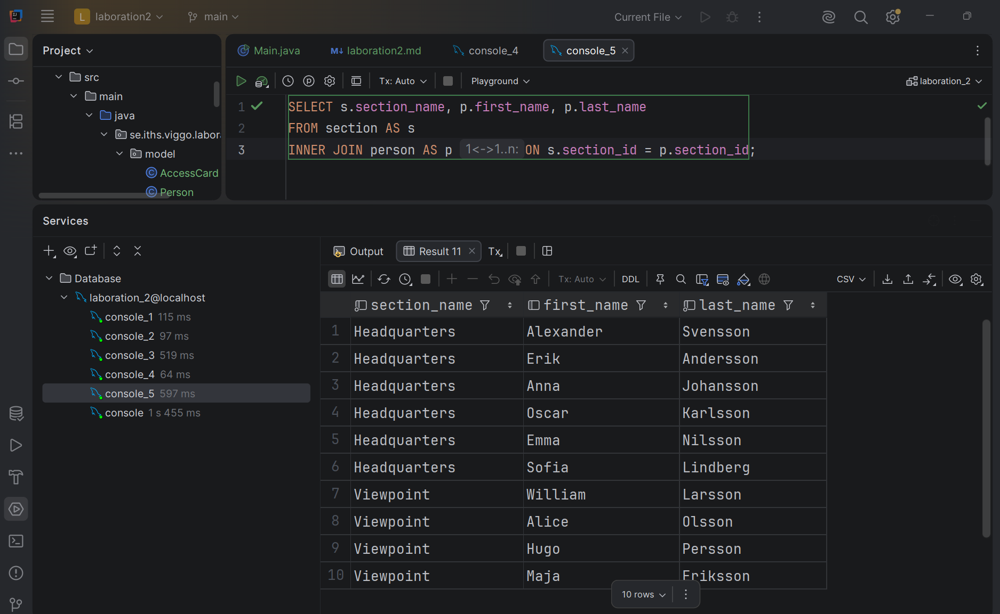

# VG4 LEFT JOIN

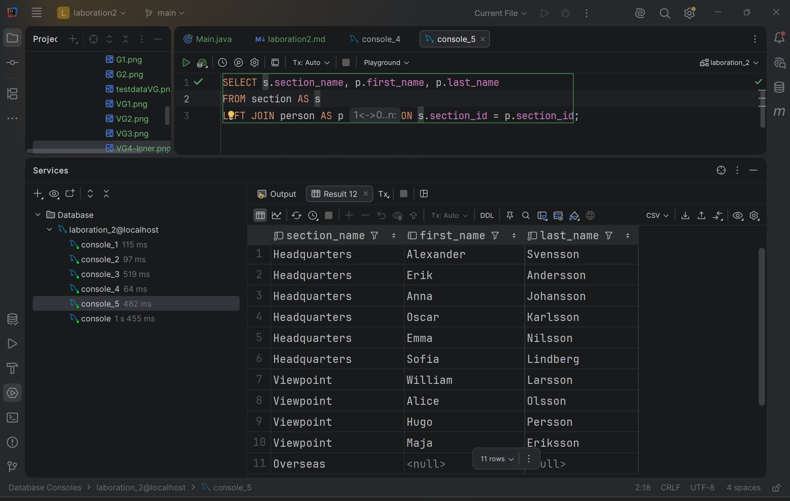

# VG5 Java programmet.

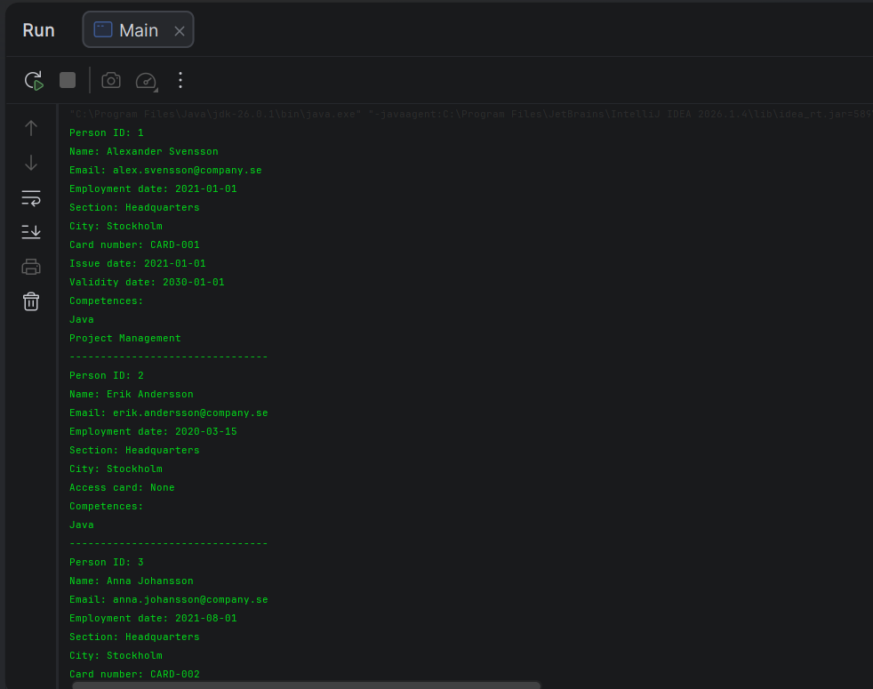
